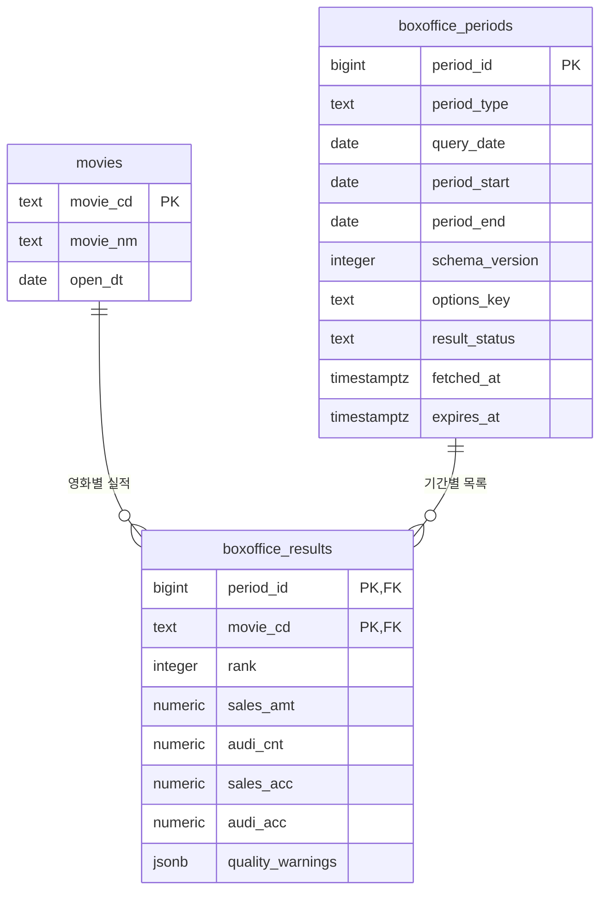

# 박스오피스 데이터 테이블 설계

기준: [ARCHITECTURE.md](./ARCHITECTURE.md), [PRD.md](./PRD.md)

## 1. 저장할 데이터

| 분류 | 데이터 | KOBIS 대응 및 의미 |
| --- | --- | --- |
| 영화 | 영화 코드, 이름, 개봉일 | `movieCd`, `movieNm`, `openDt` |
| 조회 기간 | 기간 유형, 기준일, 실제 집계 시작일·종료일 | 일간/주간/주말, 요청 날짜, 응답의 실제 집계 범위 |
| 기간별 영화 실적 | 순위, 매출, 관객수, 누적 매출, 누적 관객수 | `rank`, `salesAmt`, `audiCnt`, `salesAcc`, `audiAcc` |
| 캐시 운영 | 응답 상태, 조회 시각, 만료 시각, 스키마 버전, 조회 옵션 | 정상 데이터와 정상 빈 응답 구분, TTL 및 캐시 식별 |
| 데이터 품질 | 필드별 검증 경고 | 잘못된 숫자·누락값을 0과 구분 |

금액은 원, 관객수는 명 단위다. KOBIS는 숫자도 문자열로 반환하므로 서버에서 정수 형식과 범위를 검증한다. 영화 코드는 숫자처럼 보여도 식별자이므로 문자열로 유지한다. 누적 수치는 각 응답의 기준 시점 스냅샷이며 기간별로 합산하지 않는다.

## 2. 하나의 표에 모두 담으면 생기는 문제

단일 표를 `(유형, 기준일, 영화 코드, 영화명, 개봉일, 순위, 매출, 관객수, 누적 매출, 누적 관객수, 조회 시각, 만료 시각, …)`으로 만들면 영화 정보는 날짜마다, 조회 기간 정보는 영화마다 반복된다.

| 이상 | 구체적인 문제 |
| --- | --- |
| 삽입 이상 | 실적이 없는 영화를 미리 등록하기 어렵다. 정상 빈 응답은 영화 행이 없어서 조회 기간·성공 상태·만료 시각을 기록할 수 없으며, 억지로 넣으면 영화 코드가 없는 가짜 실적 행이 필요하다. |
| 수정 이상 | 영화명이나 개봉일 정정 시 해당 영화의 모든 날짜 행을 수정해야 한다. 일부만 수정하면 같은 코드에 서로 다른 이름이 남는다. 기간의 만료 시각도 영화 행마다 수정하면 값이 불일치할 수 있다. |
| 삭제 이상 | 한 영화의 마지막 실적 행을 지우면 영화 정보까지 사라진다. 특정 기간의 실적을 모두 지우면 그 기간의 조회 성공·빈 결과·만료 정보도 함께 사라진다. |

영화 코드는 영화 정보를 결정하고, 조회 기간 식별자는 기간·캐시 정보를 결정하며, `(조회 기간, 영화)` 조합은 해당 실적을 결정한다. 이 의존 관계에 따라 세 테이블로 분리한다.

## 3. 세 테이블과 키

### movies — 영화

| 컬럼 | Postgres 타입 | 키·제약 | 설명 |
| --- | --- | --- | --- |
| movie_cd | text | PK | KOBIS 영화 코드 |
| movie_nm | text | NOT NULL | 영화명 |
| open_dt | date | NULL 허용 | 개봉일. 원본이 없으면 NULL |

최신 검증된 영화 정보를 한 번 저장한다. 이름·개봉일 정정은 한 행만 변경하면 된다. 이 설계는 조회 당시 영화명 이력을 보존하지 않으며, 과거 실적도 현재 영화 정보와 JOIN한다. 이력 보존이 필요해지면 별도 설계가 필요하다.

### boxoffice_periods — 조회 기간 및 캐시 메타데이터

| 컬럼 | Postgres 타입 | 키·제약 | 설명 |
| --- | --- | --- | --- |
| period_id | bigint | PK, generated always as identity | 조회 기간 식별자 |
| period_type | text | NOT NULL, CHECK | `daily`, `weekly`, `weekend` 중 하나 |
| query_date | date | NOT NULL | 사용자 조회 기준일, 한국 날짜 기준 |
| period_start | date | NOT NULL | 응답의 실제 집계 시작일 |
| period_end | date | NOT NULL | 응답의 실제 집계 종료일, 시작일 이상 |
| schema_version | integer | NOT NULL | 초기값 1 |
| options_key | text | NOT NULL | 고정 외부 조회 옵션의 정규화 문자열, 기본값 `default` |
| result_status | text | NOT NULL, CHECK | `ok` 또는 `empty` |
| fetched_at | timestamptz | NOT NULL | 마지막 성공 응답 수신 시각 |
| expires_at | timestamptz | NOT NULL | 캐시 만료 시각, fetched_at 이후 |

**UNIQUE:** `(schema_version, period_type, query_date, options_key)`. 같은 요청의 캐시 행이 중복되지 않도록 한다. 검색어·Top 개수는 외부 원본을 바꾸지 않으므로 키에 포함하지 않는다. 외부 필터가 바뀌면 options_key도 달라져야 한다.

기준일이 서로 달라도 실제 주간 집계 범위가 같을 수 있다. 이 테이블은 ARCHITECTURE.md의 요청 날짜별 캐시 식별을 따르므로 별도 행으로 저장할 수 있다. 같은 주간의 중복 요청 행을 합산하면 중복 집계가 되므로 인사이트는 일간 데이터만 사용한다.

### boxoffice_results — 기간별 영화 실적

| 컬럼 | Postgres 타입 | 키·제약 | 설명 |
| --- | --- | --- | --- |
| period_id | bigint | PK 일부, FK → boxoffice_periods.period_id | 조회 기간 |
| movie_cd | text | PK 일부, FK → movies.movie_cd | 영화 |
| rank | integer | NULL 허용, 값이 있으면 > 0 | 기간 내 순위 |
| sales_amt | numeric(30,0) | NULL 허용, 값이 있으면 >= 0 | 기간 매출(원) |
| audi_cnt | numeric(30,0) | NULL 허용, 값이 있으면 >= 0 | 기간 관객수(명) |
| sales_acc | numeric(30,0) | NULL 허용, 값이 있으면 >= 0 | 응답 기준 누적 매출(원) |
| audi_acc | numeric(30,0) | NULL 허용, 값이 있으면 >= 0 | 응답 기준 누적 관객수(명) |
| quality_warnings | jsonb | NOT NULL, 기본값 `[]` | 검증 실패 필드와 사유. 비밀값 제외 |

**복합 PK:** `(period_id, movie_cd)`. 같은 조회 기간에 같은 영화의 실적을 두 번 저장할 수 없다. 순위는 식별자가 아니므로 PK로 사용하지 않는다.

**FK 삭제 정책:** 기간 삭제는 실적에 `ON DELETE CASCADE`, 영화 삭제는 `ON DELETE RESTRICT`를 적용한다. 실적 삭제로 영화나 기간이 역으로 삭제되지는 않는다. 영화별 추이 조회를 위해 `boxoffice_results(movie_cd, period_id)` 인덱스를 추가한다.

`numeric(30,0)`은 관계형 컬럼에서 정확한 정수 계산을 하기 위한 선택이다. 소수 입력을 DB가 반올림하도록 맡기지 말고 서버에서 정수 문자열인지 먼저 검증한다. NULL은 누락·오류이며 0은 실제 0이다. 숫자 정밀도를 잃지 않도록 Supabase 응답용 뷰/RPC에서 금액·관객수를 `::text`로 반환하고, 서버는 BigInt로 계산한다. 이는 ARCHITECTURE.md의 JSONB 정수 문자열 원칙을 관계형 저장에 적용한 방식이다.

## 4. 관계도



영화 하나는 실적이 0개 이상이고, 조회 기간 하나도 실적이 0개 이상이다. 각 실적은 반드시 영화 한 개와 조회 기간 한 개에 속한다. 영화와 조회 기간의 다대다 관계를 실적 테이블이 연결한다. 정상 빈 응답은 기간 행만 있고 실적은 0개인 경우다.

## 5. 캐시 설계와의 연결

이 문서는 ARCHITECTURE.md의 단일 `boxoffice_cache.payload` 대신 사용할 **정규화된 저장 대안**이다. 실제 구현에서 이 방식을 채택하면 해당 문서의 캐시 모델을 함께 갱신한다. 같은 원본을 JSONB 캐시와 세 테이블 양쪽에 별도로 유지하지 않아 데이터의 기준이 중복되지 않게 한다.

검증된 응답 하나를 저장할 때 영화 upsert, 기간 upsert, 해당 기간의 기존 실적 삭제 및 새 실적 삽입을 **하나의 DB 트랜잭션**으로 처리한다. Supabase RPC 등으로 원자성을 보장하고 같은 기간 갱신을 직렬화하여, 조회자가 신·구 실적이 섞인 결과를 보지 않게 한다.

- 정상 데이터: `result_status=ok`, 실적 1개 이상, TTL 초기 제안 6시간.
- 정상 빈 응답: `result_status=empty`, 실적 0개, TTL 초기 제안 10분. 이전 실적은 같은 트랜잭션에서 제거한다.
- 외부 실패: 기존 성공 데이터와 만료 시각을 유지하고 오류는 별도 운영 로그에 기록한다. 실패를 empty로 저장하지 않는다. 허용 범위의 오래된 캐시만 안내와 함께 제공한다.
- 캐시 없음: 해당 유니크 키의 기간 행 자체가 없는 경우다. 실적 0개만 보고 빈 응답이라고 판단하지 않는다.
- `empty이면 실적 0개`, `ok이면 실적 1개 이상`은 단순 FK만으로 강제되지 않는다. 저장 RPC의 트랜잭션 검증으로 보장한다.

갱신 임대·호출 제한 등 동시성 제어는 실적의 업무 관계와 구분한다. 이 세 테이블만으로 ARCHITECTURE.md의 분산 갱신 임대까지 구현되었다고 간주하지 않으며, 구현 시 별도 운영 저장소 또는 메타데이터를 설계한다. 테이블은 서버만 접근하고 공개 클라이언트 권한을 차단한다.

## 6. 가상 데이터: 영화 2개 × 날짜 3일

모든 영화·금액은 설명용 가상 데이터다. 예시는 schema_version=1, options_key=`default`, 모든 기간 상태는 ok이고 숫자 검증 경고는 없다고 가정한다.

**movies**

| movie_cd | movie_nm | open_dt |
| --- | --- | --- |
| M001 | 달빛 항해 | 2026-10-01 |
| M002 | 서울의 별 | 2026-10-02 |

**boxoffice_periods** — 조회·만료 시각 컬럼은 표에서 생략한다.

| period_id | period_type | query_date | period_start | period_end |
| --- | --- | --- | --- | --- |
| 1 | daily | 2026-10-20 | 2026-10-20 | 2026-10-20 |
| 2 | daily | 2026-10-21 | 2026-10-21 | 2026-10-21 |
| 3 | daily | 2026-10-22 | 2026-10-22 | 2026-10-22 |

**boxoffice_results**

| period_id | movie_cd | rank | sales_amt | audi_cnt | sales_acc | audi_acc |
| --- | --- | --- | --- | --- | --- | --- |
| 1 | M001 | 1 | 10000000 | 1000 | 100000000 | 10000 |
| 1 | M002 | 2 | 8000000 | 800 | 80000000 | 8000 |
| 2 | M001 | 2 | 9000000 | 900 | 109000000 | 10900 |
| 2 | M002 | 1 | 12000000 | 1200 | 92000000 | 9200 |
| 3 | M001 | 1 | 15000000 | 1500 | 124000000 | 12400 |
| 3 | M002 | 2 | 11000000 | 1100 | 103000000 | 10300 |

### 3일분 목록 JOIN

```sql
SELECT
    p.query_date,
    p.period_type,
    p.period_start,
    p.period_end,
    r.rank,
    m.movie_cd,
    m.movie_nm,
    m.open_dt,
    r.sales_amt::text AS sales_amt,
    r.audi_cnt::text AS audi_cnt,
    r.sales_acc::text AS sales_acc,
    r.audi_acc::text AS audi_acc
FROM boxoffice_periods AS p
JOIN boxoffice_results AS r ON r.period_id = p.period_id
JOIN movies AS m ON m.movie_cd = r.movie_cd
WHERE p.period_type = 'daily'
  AND p.query_date BETWEEN DATE '2026-10-20' AND DATE '2026-10-22'
  AND p.schema_version = 1
  AND p.options_key = 'default'
  AND p.result_status = 'ok'
ORDER BY p.query_date, r.rank NULLS LAST, m.movie_cd;
```

실제 API에서는 날짜·유형을 바인딩 파라미터로 전달한다. 목록 화면은 `p.query_date = :query_date`로 특정 날짜만 선택한다. SQL 예시는 관계를 설명하는 것이므로 만료 조건을 생략했으며, 실제 제공 여부는 서버가 expires_at과 오래된 캐시 허용 정책으로 판단하고 표시한다.

**JOIN 결과 화면 예시** — 내부의 문자열 숫자는 화면에서 천 단위 구분 기호와 단위를 적용한다.

| 기준일 | 순위 | 영화명 | 개봉일 | 매출(원) | 관객수(명) | 누적 매출(원) | 누적 관객수(명) |
| --- | --- | --- | --- | --- | --- | --- | --- |
| 2026-10-20 | 1 | 달빛 항해 | 2026-10-01 | 10,000,000 | 1,000 | 100,000,000 | 10,000 |
| 2026-10-20 | 2 | 서울의 별 | 2026-10-02 | 8,000,000 | 800 | 80,000,000 | 8,000 |
| 2026-10-21 | 1 | 서울의 별 | 2026-10-02 | 12,000,000 | 1,200 | 92,000,000 | 9,200 |
| 2026-10-21 | 2 | 달빛 항해 | 2026-10-01 | 9,000,000 | 900 | 109,000,000 | 10,900 |
| 2026-10-22 | 1 | 달빛 항해 | 2026-10-01 | 15,000,000 | 1,500 | 124,000,000 | 12,400 |
| 2026-10-22 | 2 | 서울의 별 | 2026-10-02 | 11,000,000 | 1,100 | 103,000,000 | 10,300 |

INNER JOIN은 실적이 있는 행만 반환하므로 정상 빈 응답을 구분하려면 먼저 기간 행의 존재 여부와 상태를 확인한다. 기간별 상태를 한 번에 조회하려면 기간을 기준으로 실적을 LEFT JOIN한다. 실적이 없는 행의 NULL을 0으로 바꾸지 않는다.

### 같은 3일의 영화별 합계

```sql
SELECT
    m.movie_cd,
    m.movie_nm,
    SUM(r.sales_amt)::text AS period_sales_amt,
    SUM(r.audi_cnt)::text AS period_audi_cnt
FROM boxoffice_periods AS p
JOIN boxoffice_results AS r ON r.period_id = p.period_id
JOIN movies AS m ON m.movie_cd = r.movie_cd
WHERE p.period_type = 'daily'
  AND p.query_date BETWEEN DATE '2026-10-20' AND DATE '2026-10-22'
  AND p.schema_version = 1
  AND p.options_key = 'default'
  AND p.result_status = 'ok'
GROUP BY m.movie_cd, m.movie_nm
ORDER BY SUM(r.sales_amt) DESC NULLS LAST,
         SUM(r.audi_cnt) DESC NULLS LAST,
         m.movie_cd
LIMIT 5;
```

| 영화 코드 | 영화명 | 3일 매출 합계(원) | 3일 관객수 합계(명) |
| --- | --- | --- | --- |
| M001 | 달빛 항해 | 34,000,000 | 3,400 |
| M002 | 서울의 별 | 31,000,000 | 3,100 |

이 합계 예시는 모든 값이 유효한 경우다. 실제 집계에서 SQL SUM은 NULL을 무시하므로 NULL 개수와 날짜별 완전성을 별도로 검사하고 부분 집계 경고를 함께 반환해야 한다. 응답에 영화가 없는 날을 관객 0명으로 단정하지 않으며, 일간·주간·주말 실적을 섞어 합산하지 않는다. 누적 매출·누적 관객수는 SUM 대상에 포함하지 않는다.
